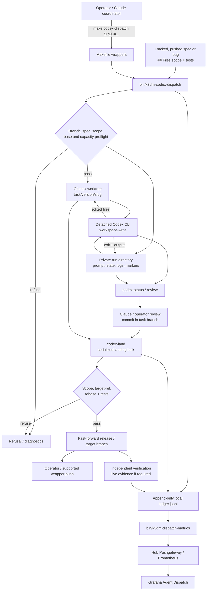
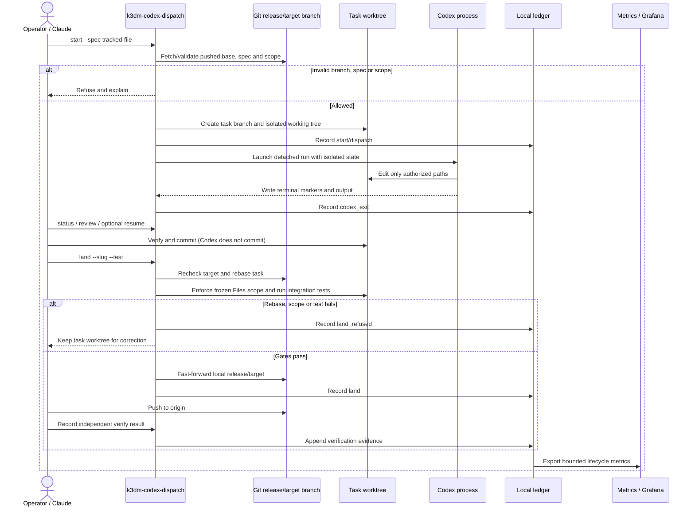
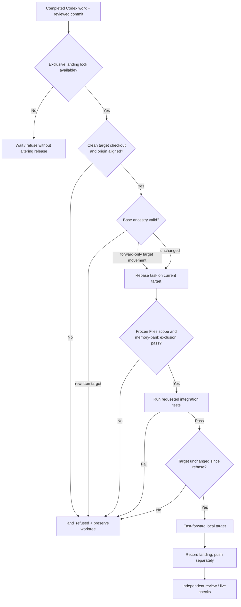

# Architecture: k3dm-codex-dispatch

**Status:** architecture reference based on `k3d-manager-v1.43.9` (2026-10-26)  
**Implementation:** [`bin/k3dm-codex-dispatch`](../../bin/k3dm-codex-dispatch)  
**Operator procedure:** [`docs/howto/codex-dispatch.md`](../howto/codex-dispatch.md)  
**Design history:** [v1.43.0 worktree isolation](../plans/v1.43.0-worktree-isolated-codex-dispatch.md), [v1.43.7 cross-repo dispatch](../plans/v1.43.7-codex-dispatch-cross-repo.md)

## Purpose and ownership

The dispatcher translates a tracked spec or bug into an **isolated Codex implementation run** with durable local evidence, scoped changes, a guarded Git landing process, and metrics. It is not a general-purpose remote shell, a production deployment controller, or an autonomous merge-to-main service.

The operator/Claude chooses the spec, reviews work and authorizes landing. Codex edits its own task worktree but does **not** commit or push. Landing, independent verification, live verification and release promotion remain separate lifecycle stages. These trust boundaries are as important as parallelism.

## Component and data-flow diagram



This diagram separates the local **worker and ledger data plane** from the Git **integration control plane**. The Pushgateway path is telemetry, not authorization.

## Task isolation and persistent state

```text
~/.local/share/k3d-manager/worktrees/        # K3DM_WORKTREE_ROOT override
├── ledger.jsonl                             # append-only dispatch lifecycle
└── v1.43.9/
    ├── example/                             # isolated Git worktree
    │   └── branch task/v1.43.9/example
    └── example.run/                         # private run/evidence folder
        ├── prompt.md
        ├── codex.log
        ├── supervisor.log
        ├── last-message.md
        ├── start / pid / exit / codex-exit-ts
        └── state/                            # jobs, run, logs, tmp, port cache
```

The dispatcher supplies per-task `K3DM_REPO_ROOT`, `K3DM_JOB_DIR`, `K3DM_RUN_DIR`, `K3DM_STATE_DIR`, `K3DM_LOG_DIR`, `K3DM_TMP_ROOT`, `K3DM_PORT_CACHE_DIR` and `TMPDIR`. This keeps transient task state away from the live webhook and other tasks; it **does not** isolate CPU, RAM, network or all host resources. Network-enabled tasks have an additional exclusive scheduling restriction; normal tasks may overlap. A detached supervisor records start and exit markers so loss of the initiating shell does not itself imply task failure.

## End-to-end lifecycle



### States and authoritative evidence

| Stage | Source of truth | What it proves / does not prove |
|---|---|---|
| Dispatch accepted | Run directory + `start` ledger event | Task initialized; not implemented |
| Worker running / exited | `start`, `pid`, `exit`, `codex-exit-ts`, `supervisor.log` | Runtime outcome; zero exit does **not** imply accepted code |
| Review and scope | Frozen spec `## Files`, Git diff, required tests | Constrained implementation; not automatically live-verified |
| Landing | Git target SHA, `land` or `land_refused` event | Integrated code passed landing gates; may be awaiting push/review |
| Independent verification | `verify` event and verifier evidence | Review status; does not imply live verification |
| Operational evidence | Spec live-evidence metadata | Live verification only if required evidence is present and valid |
| Delivery dashboard | Aggregated `ledger.jsonl` / metrics | Observability with explicit unknown/coverage states, not authorization |

## Landing safety and concurrency



Landing is serialized even though implementation may be parallel. It rechecks the actual target ref to prevent force-push/rewrite or intervening commits from silently invalidating review. `--allow-out-of-scope` is an explicit, reviewed exception, not the normal route. `memory-bank/**` remains prohibited in task changes. This process does **not** create or merge a PR into `main` or deploy Hostinger.

## Other repositories

With `REPO` and `BRANCH`, the spec remains in the k3d-manager release branch, while the implementation worktree, task branch and landing target belong to a separately pushed work-repository branch. The run folder persists work-repo, target, base and a frozen spec snapshot. Every lifecycle ledger event carries the work-repo identity; legacy task records without those fields retain their historical k3d-manager behavior. The same target movement, scope, and independent test gates apply.

## Operator commands and failure recovery

See the operator guide for exact usage and preconditions:

```bash
make codex-dispatch SPEC=docs/plans/<spec>.md
make codex-status
make codex-resume SLUG=<slug> PROMPT=/path/to/follow-up.md
make codex-land SLUG=<slug> TEST="bats scripts/tests/bin/codex_dispatch.bats"
make codex-land-pending SLUG=<slug> TEST="bats scripts/tests/bin/codex_dispatch.bats"
make codex-prune
make dispatch-metrics DRY_RUN=1
```

`codex-land-pending` is an explicitly documented operator escape hatch when Claude is unavailable: it requires a successfully exited worker and clean/synchronized checkout, lands and pushes, records **Claude review pending**, but does not mark the task verified. Do not conflate it with authorization to run a live `platform-ops`, `appsets-reapply`, or webhook restart.

In an outage or quota-limited handoff, first inspect status, run directory, ledger and Git refs. Do not re-dispatch blindly, discard a worktree, force a target branch, weaken tests, or mark tasks verified from a Codex zero exit. Record any independent reviewer and live evidence before advancing release-readiness status.

## Operational and security limitations

- The execution isolation boundary is a Git worktree plus scoped writable runtime state; host CPU/memory and some dependencies remain shared.
- A `## Files` whitelist is enforced at landing, not an absolute prevention of unsafe commands while the worker runs; sandbox and tool permissions remain necessary.
- The ledger is local and append-only; out-of-band `codex exec` sessions are not automatically complete dispatcher events. Source coverage and `unknown` need to remain visible.
- The metrics path can lag a worker; a Grafana panel is a derived view, not a source of Git truth.
- Detached worker survival after terminal disconnection is not equivalent to survival after host restart, quota rejection, or process termination.
- As of this architecture version, this dispatcher operates on a local host; proposed M5/M4/M2 Git-backed distributed scheduling is **future planned work**, not an existing feature of `k3dm-codex-dispatch`.

## Architecture maintenance

Update this page when dispatcher lifecycle, scope gates, ledger schema, cross-repo targeting, pending landing, or metric semantics change. Keep the operator guide focused on commands and troubleshooting; keep acceptance and change history in the versioned `docs/plans` specifications. Ensure architecture diagrams continue to describe **implemented** behavior rather than proposals.
