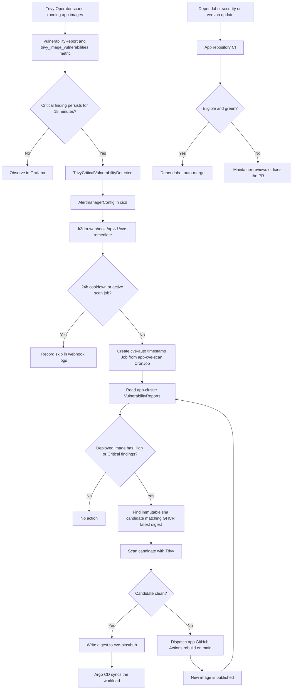

# CVE Detection and Remediation Pipeline

This guide describes the security loop for the shopping-cart workloads. It has two
remediation paths:

- **Image remediation:** promote a clean immutable image, or trigger a rebuild
  when no clean candidate exists.
- **Dependency remediation:** Dependabot opens an update PR for CVEs that require
  a source dependency change; eligible green PRs auto-merge under each app repo's
  policy.

The image path is an automated attempt, not a guarantee that every CVE can be
patched without a source change.

## Flow



## Components

| Component | Responsibility |
|---|---|
| Trivy Operator | Scans running Kubernetes workloads and writes `VulnerabilityReport` CRs. |
| PrometheusRule | Fires `TrivyCriticalVulnerabilityDetected` when `trivy_image_vulnerabilities{severity="Critical"}` remains positive for 15 minutes. |
| AlertmanagerConfig | Routes the alert to both remediation and analysis receivers. |
| `bin/k3dm-webhook` | Authenticates Alertmanager, enforces idempotency, and creates an event-driven scan Job. |
| `app-cve-scan` | Evaluates reports, scans candidate images, promotes clean candidates, or dispatches a rebuild. |
| Argo CD | Renders the pin from `cve-pins/hub` in the `services-git` template and reconciles the workload. |
| Dependabot | Covers dependency updates that an image rebuild cannot repair by itself. |

## Safeguards

- The alert must remain active for **15 minutes** before remediation is requested.
- The webhook uses a **24-hour cooldown** keyed by `namespace` and
  `image_repository`.
- Only one active `app-cve-scan` or `cve-auto-*` Job is allowed at a time.
- Promotion requires an immutable `sha-*` tag that resolves to the registry's
  current `latest` digest and passes a new High/Critical Trivy scan.
- The promoted image is pinned as `<repository>@<digest>`.
- If no clean candidate exists, the scan dispatches the service's GitHub Actions
  workflow on `main`; promotion waits for the next clean candidate.
- Missing reports cause a non-zero scan result rather than a false-green run.

## Prerequisites

- `platform-ops` is deployed on the hub through Argo CD bootstrap.
- The hub Prometheus/Alertmanager stack has `alertmanagerConfigMatcherStrategy:
  {type: None}` so the cluster-wide alert is not restricted to the `cicd`
  namespace.
- `cicd/k3dm-webhook-token` exists and matches the webhook bearer token.
- `platform-ops` has a `GH_TOKEN` with package-read access for GHCR and workflow
  dispatch access for the shopping-cart repositories.
- The app-cluster registration secret is present in `cicd` so `app-cve-scan` can
  read the app cluster's `VulnerabilityReport` objects.

## Observe and Validate

Use the Hub Grafana dashboards to view critical findings, remediation-job outcomes,
and webhook activity. The existing [Trivy Operator observability guide](trivy-operator-observability.md)
covers scan metrics and operator failures.

Useful live checks:

```bash
# Current critical findings by app namespace and repository.
kubectl --context ubuntu-hostinger get vulnerabilityreports -A

# Event-driven and scheduled scan Jobs.
kubectl --context k3d-k3d-cluster -n platform-ops get jobs

# Decision and promotion logs.
kubectl --context k3d-k3d-cluster -n platform-ops logs job/<cve-auto-job>

# Webhook cooldown and dispatch decisions.
tail -f ~/.k3dm/logs/k3dm-webhook.log
```

The source configuration is:

- `scripts/etc/argocd/platform-ops/prometheusrule.yaml`
- `scripts/etc/argocd/platform-ops/alertmanager-config.yaml`
- `scripts/etc/argocd/platform-ops/app-cve-scan.sh`
- `bin/k3dm-webhook`

## Failure Handling

| Symptom | Likely cause | First action |
|---|---|---|
| Alert fires but no Job appears | webhook token, Alertmanager route, cooldown, or an active scan Job | Check Alertmanager delivery and webhook logs. |
| Job exits with `ZERO VulnerabilityReports matched` | app report repository does not match the configured GHCR path | Compare `.report.artifact.repository` with `APP_IMAGE_PREFIX`. |
| Candidate missing | no immutable `sha-*` tag matches `latest` | Check the app publish workflow and GHCR tags. |
| Candidate remains vulnerable | the fix needs a source/dependency update | Inspect the dispatched build and Dependabot PRs. |
| Dependabot PR stays open | CI, review policy, or an incompatible major update | Fix CI or review the dependency change; majors are intentionally not auto-merged. |

## Maintenance

Run the focused regression tests when changing the webhook or scan behavior:

```bash
bats scripts/tests/lib/webhook.bats
bats scripts/tests/plugins/app_cve_scan.bats
bats scripts/tests/plugins/trivy_operator_observability.bats
```

## Pin branch

The promoter writes `pins.json` on `cve-pins/hub`. Its schema is
`{"v":1,"cvePins":{"<service>":{"digest":"sha256:<64 lowercase hex>","base":"<digest or none>","at":"<UTC YYYY-MM-DDTHH:MM:SSZ>"}}}`.
An empty map runs every service at its base. Startup prunes pins whose base changed
on the Application's target revision and keeps pins whose base cannot be read.
All three apply paths check that the branch exists before applying services-git.

Cut over manually. Ordinary `bin/k3dm-hub-deploy` runs appsets-reapply before
platform-ops and stops at the guard on first deployment. Recover from that stop
with the same sequence:

1. Run `make hub-promote REF=<commit-ish>`, confirm with `make hub-promote-status`,
   then install the new promoter with `make platform-ops`.
2. Run `make app-cve-scan` after every `hub-promote` that changes a service image,
   or wait for its schedule. Require
   `PINSYNC: complete pins=<n> live_overrides=<m> incomplete=0`. On
   `PINSEED: incomplete`, fix read access and rerun before proceeding.
3. Run `make appsets-check` and `make appsets-reapply`. Promotions made during
   cutover take effect when the new template reconciles.

- R2e-1. The writer can choose a service digest. Its PAT retains repository write
  access until branch rules restrict it.
- R2e-2. Hubs and preflight sandboxes share pins, including when they track different releases.
- R2e-3. Losing the file can remove generated Applications. Workloads are preserved.
  Restore the validated file with a normal commit.
- R2e-4. A remote base with no local image entry records `none`. Upstream-only
  changes do not trigger pruning.
- R2e-5. `bin/k3dm-image-pin-drift` reports base pins. Inspect the rendered Application and Deployment for the effective digest.

Keep the ruleset status at `ruleset: not asserted` until the release is promoted,
the new promoter and ApplicationSet are deployed, the Application count matches
the pre-cutover count, and a rendered pin is verified on a running Deployment.
Verify that the promoter authored no deploy/hub commits after cutover.
