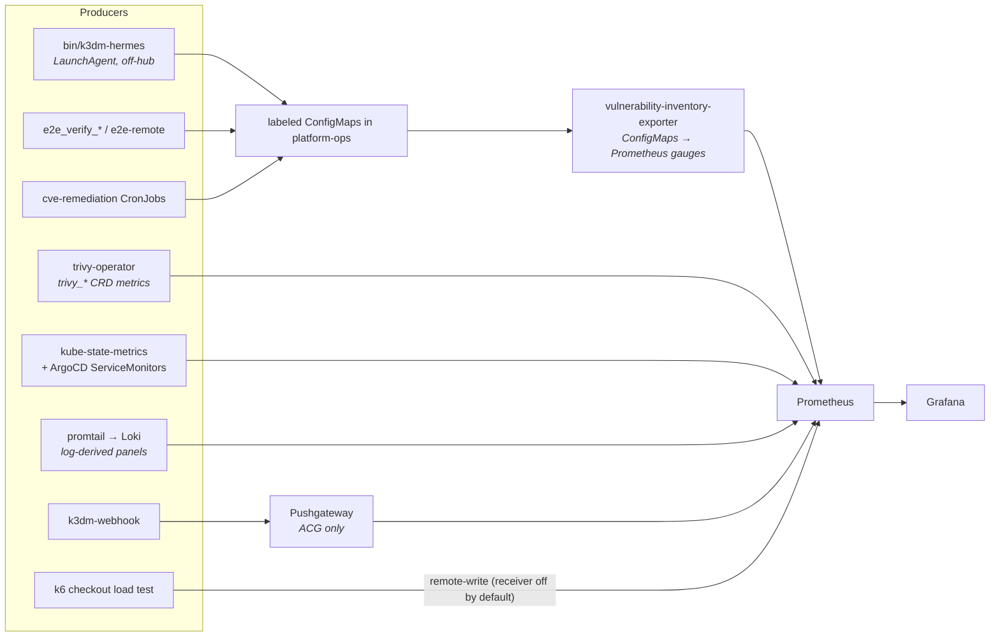

# Shared dashboard operations

[← Grafana dashboards index](../grafana-dashboards.md)

## Which Grafana am I looking at?

There are two Grafana instances — hub and ACG app-cluster — and they hold **different**
dashboards. `grafana.3ai-talk.org` must route to the **hub** instance; when the public route
was pointed at the app-cluster instance the symptom was a healthy Grafana shell rendering
`Dashboard not found`, not a 502
(`docs/issues/2026-07-08-grafana-dashboard-not-found-public-route-hit-app-cluster-instance.md`).
The mirror-image failure also happened: the ArgoCD/Image-Updater dashboard was applied to
the app cluster, where `argocd_*` and `kube_deployment_*{namespace="cicd"}` do not exist, so
every panel read `No data` while the JSON itself loaded fine
(`docs/bugs/2026-06-29-image-updater-grafana-wrong-cluster.md`).

The chart also ships a stock **`Grafana Overview`** dashboard (Firing Alerts, Dashboards, RPS).
It is not ours and none of our fixes apply to it. Ours is **`Grafana Health & Firing Alerts`**,
which has the "Firing Alerts by Category" table. Before 2026-10-02 it was titled
"Grafana Overview — Readable", and the operator kept opening the stock one by mistake
(`docs/bugs/2026-10-02-grafana-overview-readable-title-collides-with-stock-dashboard.md`).

**Check the instance before debugging the query.**

### Firing alert timing

The **Firing Alerts by Category** table remains an aggregate count by category, alert name,
severity, and cluster. The **Active Alert Instances** table is capped at 200 rows and orders its allowlist as
namespace, cluster, alert, app, pod, instance, **Active since (local; pending included)**, and
**Active for**. App, pod, and instance values appear only when the alert provides them; Trivy
alerts use `app` for the image repository and do not carry a pod label. Raw metric labels such
as `__name__`, `group`, and `tier` are hidden. Alert identity stays per-instance, so several Trivy findings under one rule can
have different active-state timestamps.

The timestamp comes from Prometheus `ALERTS_FOR_STATE`, which records when a rule entered
pending/active evaluation. A rule's `for:` interval means this can be earlier than the actual
firing transition, so it is not an exact firing start. The explicit pending-included caveat
must remain visible. Rows without this metric are omitted; an empty detail table means no
firing instance has a matching active-state sample. No resolved time is inferred.

The separate **CVE Findings — Report Created at (local)** table shows up to 200 current findings
with CVE, severity, cluster, namespace, image, workload/report owner, package, and
installed/fixed version context.
Its timestamp metric is sourced from VulnerabilityReport `metadata.creationTimestamp`. It
records when Trivy created the report object, not when the vulnerability was first detected;
reports without a valid creation timestamp do not receive a fabricated value.

## The producer chain

Dashboard data has several paths: some panels read metrics Prometheus scrapes natively, while
others depend on a producer this repo owns.

**The exporter is the load-bearing piece.** `vulnerability-inventory-exporter` is a
stdlib-Python pod in `platform-ops` that lists labeled ConfigMaps and re-emits them as
bounded Prometheus gauges. Three independent refresh paths, three label selectors:

| Selector | Feeds | Metrics |
|---|---|---|
| `k3dm.k3d.io/cve-remediation-event=true` | CVE Auto-Patch | `cve_remediation_state`, `cve_remediation_event_info`, `cve_remediation_requested/applied_timestamp_seconds` |
| `k3dm.k3d.io/e2e-result=true` | E2E Verification | `e2e_last_run_pass`, `e2e_last_run_duration_seconds`, `e2e_last_success_timestamp_seconds`, `e2e_run_info`, `e2e_failure_info`, `e2e_failure_group_info` |
| `k3dm.k3.io/hermes-status=true` | Hermes Status | `hermes_sensor_status`, `hermes_incident_active`, `hermes_last_poll_timestamp_seconds`, `hermes_status_check_info` |

> **Do not "fix" the Hermes label.** The Hermes selector is `k3dm.k3.io`, **not**
> `k3dm.k3d.io` like the other two. The publisher in `bin/k3dm-hermes` writes the same odd
> domain (`labels = "k3dm.k3.io/hermes-status=true"`), so the two agree and the dashboard
> works. Normalising it in one place and not the other silently empties the Hermes
> dashboard — the selector matches nothing and the exporter reports no error. If it is ever
> normalised, **both** files must change in the same commit.

Also note: `trivy_vulnerability_inventory` comes from the *same pod* as the remediation
gauges but a different code path. Inventory panels having thousands of series while
remediation panels show `No data` is therefore a perfectly consistent state — it means the
remediation CronJobs have not produced an event ConfigMap, not that the exporter is down
(`docs/issues/2026-08-24-cve-remediation-panels-empty.md`).

---

## Dashboard reference

## Triage: `No data` by cause

Work down this table before editing a query. Every row is a real past incident.

| Symptom | Likely cause | Check |
|---|---|---|
| Dashboard missing entirely | sidecar didn't import it; wrong namespace or missing `grafana_dashboard: "1"` | `kubectl -n monitoring get cm -l grafana_dashboard=1` |
| `Dashboard not found` in a healthy Grafana | public route points at the **app-cluster** instance | confirm which Grafana the hostname resolves to |
| *All* panels blank, JSON loads fine | dashboard applied to the wrong cluster | does the cluster even have `argocd_*` / `trivy_*`? |
| `probe_*` panels blank | blackbox-exporter or its `Probe` resources are not deployed/scraped | check the hub blackbox-exporter release and the `release`-labeled `Probe` resources |
| All `argocd_*` panels blank after a rebuild | Helm release predates the ServiceMonitor CRD; chart skipped them | `kubectl -n cicd get servicemonitor`; fix = `helm upgrade`, same values |
| Loki / LogQL panels blank after a rebuild | promtail DaemonSet absent | `kubectl get ds -A \| grep promtail` |
| LogQL panel shows a wall of `kubernetes_*` labels | `\| json` with no line filter | add the `\|= "…"` filter before `\| json` |
| `30d` / `30m` `increase()` panel blank | dashboard time range narrower than the window | widen the time picker first |
| Exporter-backed panels blank, inventory full | the ConfigMap producer never ran — different code path, same pod | `kubectl -n platform-ops get cm -l <selector>` |
| Hermes panels blank | selector/publisher label drift (`k3dm.k3.io` vs `k3dm.k3d.io`), or publication disabled | compare `bin/k3dm-hermes` to the exporter; check *Minutes since last poll* |
| Alertmanager delivers nothing on one cluster | the CR references a `configSecret` that does not exist | `kubectl -n monitoring get alertmanager -o jsonpath='{.items[0].spec.configSecret}'` then `get secret` on that name |
| E2E detail panels blank, summary panels fine | result event carries aggregates only | inspect the newest `e2e-result` ConfigMap payload |
| E2E entirely blank after a real remote run | `E2E_M2_PUBLISH_BACK_HOST` unset under launchd; result stuck `publication_pending` | count `k3dm.k3d.io/e2e-result` ConfigMaps on the hub |
| k3dm Deployment panels blank | `k3dm Deployment Metrics` is empty: the Pushgateway release must be installed on the app cluster, the local `:9091` port-forward agent must be loaded, and the `job="pushgateway"` target must be up | `curl -s -o /dev/null -w '%{http_code}' http://localhost:9091/-/healthy` |
| sandbox Prometheus panels blank / `federate-acg` TargetDown | the `com.k3d-manager.sandbox.prometheus-port-forward` agent is not loaded | `launchctl list com.k3d-manager.sandbox.prometheus-port-forward` and `curl -s -o /dev/null -w '%{http_code}' http://localhost:19190/-/ready` |
| Checkout Load Test blank except CPU | no producer — expected | nothing to fix |
| k3dm Tests panels blank | nobody has run `make test-all`/`make test-metrics` yet, or the Pushgateway forward is unavailable | check the *Suite freshness* panel: `No data` means never pushed, a large age means the push stopped |
| Host disk panels show `No data` | Hermes is not running or the hub Pushgateway port-forward is down | check Hermes and the *Last push age* panel |
| **k3dm Host Pod IP Pool** shows `No data`, `Probe status` down, or a high `Pool used %` | `No data`: Hermes or the hub Pushgateway port-forward is down. `Probe status` down: the collector cannot read `/var/lib/k3dm/cni-ipam-sweep.state` over SSH. High usage with `Stale reservations removed` at 0: real pod load, not a leak | `systemctl list-timers k3dm-cni-ipam-sweep.timer` and the state file on the host; `bin/k3dm-cni-ipam-metrics --dry-run` on the hub |
| Replica stat shows several `1`s | kube-state-metrics pod-IP churn | cosmetic; wrap in `max()` |

The deployment metrics live in the **app-cluster** Prometheus, not the hub's. The hub's own
Pushgateway (`hub-pushgateway`, port-forwarded to `localhost:19094`) carries only host-side
gauges such as vector-DB health and host disk.

---

## Adding or changing a dashboard

1. Edit the ConfigMap YAML under `scripts/etc/argocd/platform-ops/` (hub, via
   `make platform-ops`) or `scripts/etc/grafana/dashboards/` (ACG, via
   `make observability-acg`). Keep `grafana_dashboard: "1"` and `namespace: monitoring`.
2. If the panel needs a series nothing produces yet, **add the producer first** — a panel
   without a producer becomes a permanent `No data` that the next person has to re-diagnose.
   The Checkout Load Test dashboard is what that looks like.
3. Prefer `or vector(0)` on counting panels so an honest zero reads as `0`, not `No data` —
   the existing dashboards do this deliberately and it removes a whole class of false alarm.
4. Re-apply, then confirm the series exists rather than trusting the render:
   `kubectl -n monitoring exec … -- promtool query instant` or the Grafana Explore tab.
5. **Reapply the ApplicationSets after a release.** Dashboards templated through
   ApplicationSets freeze their `$values` ref to whatever branch was checked out when the
   set was last applied — config on a newer branch is inert until reapplied. Then confirm
   with `argocd_check_values_branch`. See `CLAUDE.md`.

---

## Where to look next

- `docs/guides/hermes.md` — the Hermes agent, its five sensors, and the correlator.
- `docs/architecture/cloudflare-slack-relay.md` §3 — the Pushgateway metrics path.
- `docs/guides/vcluster-e2e-harness.md` — what produces the e2e result events.
- `scripts/etc/argocd/platform-ops/vulnerability-inventory-exporter.yaml` — the exporter.
- `scripts/plugins/observability.sh` — `deploy_observability`, `_deploy_pushgateway_acg`,
  `_observability_apply_trivy_dashboard`, `observability_status`.
