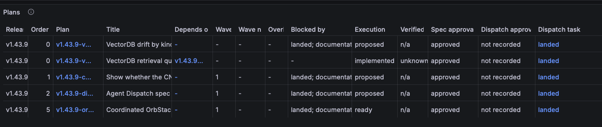
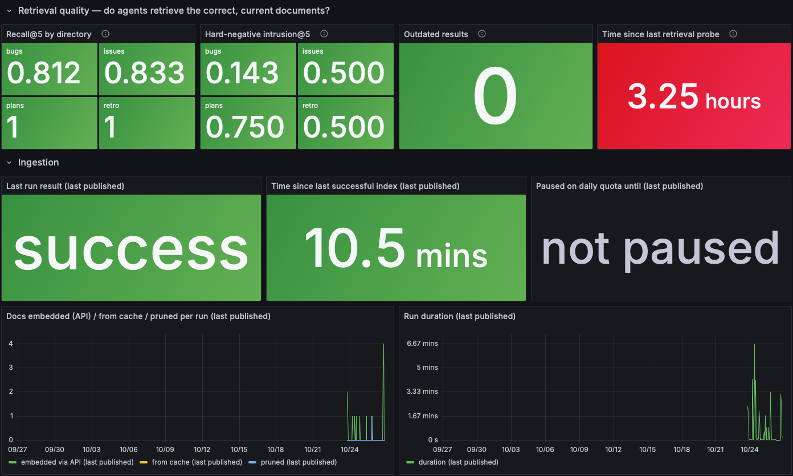

# Hermes SSH and Plans P3 live verification

**Status:** Both fixes LIVE-VERIFIED from operator and read-only runtime evidence
**Priority:** P2

## What was checked

Hermes fix `3aae7adc182094630ca4d93a9e439fd262ce5f65` and Plans P3 fix
`608b90a16a01c2009ce9da26646878bfffd6667c`, on M4 and its hub. The operator
supplied terminal output and two Grafana screenshots, then refreshed the Plans
page and supplied the corrected table screenshot. Assistant checks were
read-only: tmux history, LaunchAgent/source metadata, published index metrics,
Argo CD state, dashboard ConfigMap/file, and Grafana dashboard API. No assistant
sync, restart, credential change, index invocation, or retrieval probe was run.

## Operator screenshots





## Operator terminal output

The operator supplied the following full health-cycle JSON, followed by the
metrics commands/output. They clarified this was probably an iTerm pane, rather
than tmux. The default M4 tmux server `work` contained older history and none of
these commands; it was not used as proof that the commands were absent.

```text
{"records": [{"sensor": "eso", "status": "healthy", "evidence": "Ready=True; 20/20 synced; Ready=True; 9/9 synced", "sampled_at": "2026-10-27T03:01:38Z", "data": {}}, {"sensor": "argocd", "status": "healthy", "evidence": "33 applications healthy", "sampled_at": "2026-10-27T03:01:50Z", "data": {}}, {"sensor": "values_branch", "status": "healthy", "evidence": "21 references on k3d-manager-v1.43.9", "sampled_at": "2026-10-27T03:01:52Z", "data": {"expected": "k3d-manager-v1.43.9", "stale": [], "checked": 21, "tracking_head": 2}}, {"sensor": "reachability", "status": "healthy", "evidence": "public endpoints healthy", "sampled_at": "2026-10-27T03:02:13Z", "data": {}}, {"sensor": "node_pressure", "status": "healthy", "evidence": "all readable nodes healthy", "sampled_at": "2026-10-27T03:02:16Z", "data": {"problems": [], "unreadable": []}}, {"sensor": "data_layer", "status": "healthy", "evidence": "4/4 ready", "sampled_at": "2026-10-27T03:03:07Z", "data": {}}, {"sensor": "hostnet_drift", "status": "healthy", "evidence": "no host-network pods on stale IPs", "sampled_at": "2026-10-27T03:03:09Z", "data": {"drifted": []}}, {"sensor": "superseded_jobs", "status": "healthy", "evidence": "no superseded failed Jobs", "sampled_at": "2026-10-27T03:03:09Z", "data": {"context": "k3d-k3d-cluster", "jobs": [], "unreadable": []}}, {"sensor": "kine", "status": "healthy", "evidence": "state.db 556.1 MiB; last compaction 3m ago", "sampled_at": "2026-10-27T03:03:21Z", "data": {"state_db_bytes": 583081984, "slow_sql_count": 22, "compaction_recent": true, "compaction_failed": false, "stale_acg_registration": false, "last_compaction_ts": 1793070010.907855}}, {"sensor": "vectordb", "status": "healthy", "evidence": "rows=2304, corpus=2304, indexed 0.0d ago", "sampled_at": "2026-10-27T03:04:06Z", "data": {"available": true, "external_secret_synced": true, "pod_ready": true, "rows": 2304, "corpus_docs": 2304, "last_indexed_epoch": 1793069881.431263}}, {"sensor": "alert_delivery", "status": "healthy", "evidence": "2 Alertmanager route tree(s) can deliver", "sampled_at": "2026-10-27T03:04:13Z", "data": {"clusters": 2, "blackout": []}}, {"sensor": "ci", "status": "healthy", "evidence": "required CI checks successful", "sampled_at": "2026-10-27T03:04:16Z", "data": {}}, {"sensor": "app_health", "status": "healthy", "evidence": "1 service(s) agree with their probe groups (a group-visible outage is covered by the argocd sensor, not this one)", "sampled_at": "2026-10-27T03:04:17Z", "data": {}}], "event": null, "approvals": [], "pages": []}

^C

curl -fsS http://127.0.0.1:19094/metrics |
  grep -E '^k3dm_vectordb_index_last_(run_timestamp_seconds|result)'
rg: error parsing flag -E: grep config error: unknown encoding: ^k3dm_vectordb_index_last_(run_timestamp_seconds|result)
curl: (23) Failure writing output to destination, passed 2048 returned 0

curl -fsS http://127.0.0.1:19094/metrics |
  grep '^k3dm_vectordb_index_last_(run_timestamp_seconds|result)'
k3dm_vectordb_index_last_result{instance="",job="k3dm-vectordb-index",result="failed"} 0
k3dm_vectordb_index_last_result{instance="",job="k3dm-vectordb-index",result="noop"} 0
k3dm_vectordb_index_last_result{instance="",job="k3dm-vectordb-index",result="paused"} 0
k3dm_vectordb_index_last_result{instance="",job="k3dm-vectordb-index",result="success"} 1
k3dm_vectordb_index_last_run_timestamp_seconds{instance="",job="k3dm-vectordb-index"} 1.7930698235527549e+09
```

The shell aliases grep to rg, where `-E` selects an encoding. Curl's write error
was the downstream pipeline closing, not evidence of a failed metrics endpoint.
The second command succeeded. Use an explicit executable for future checks:

```bash
curl -fsS http://127.0.0.1:19094/metrics |
  /usr/bin/grep -E '^k3dm_vectordb_index_last_(run_timestamp_seconds|result)'
```

## Independent Hermes runtime correlation

Actual selected output from read-only source/process/metric checks:

```text
Evidence captured UTC: 2026-10-27T03:13:07.393270+00:00
LaunchAgent program: ['/opt/homebrew/bin/python3', '/Users/cliang/src/gitrepo/personal/k3d-manager/bin/k3dm-hermes']
launchd SSH_AUTH_SOCK: unset
plist SSH_AUTH_SOCK: unset
launchd GIT_SSH_COMMAND: unset
plist GIT_SSH_COMMAND: unset
LaunchAgent PID: 77982
Process started: Mon Oct 26 20:06:35 2026
Hermes source commit: 3aae7adc182094630ca4d93a9e439fd262ce5f65
Hermes source dirty: False
Latest logged VectorDB record: [{"sensor": "vectordb", "status": "healthy", "evidence": "rows=2304, corpus=2304, indexed 0.0d ago", "sampled_at": "2026-10-27T03:04:06Z", "data": {"available": true, "external_secret_synced": true, "pod_ready": true, "rows": 2304, "corpus_docs": 2304, "last_indexed_epoch": 1793069881.431263}}]
k3dm_vectordb_index_last_result{instance="",job="k3dm-vectordb-index",result="failed"} 0
k3dm_vectordb_index_last_result{instance="",job="k3dm-vectordb-index",result="noop"} 0
k3dm_vectordb_index_last_result{instance="",job="k3dm-vectordb-index",result="paused"} 0
k3dm_vectordb_index_last_result{instance="",job="k3dm-vectordb-index",result="success"} 1
k3dm_vectordb_index_last_run_timestamp_seconds{instance="",job="k3dm-vectordb-index"} 1.793070425180833e+09
  UTC: 2026-10-27T03:07:05.180833+00:00
k3dm_vectordb_index_last_success_timestamp_seconds{instance="",job="k3dm-vectordb-index"} 1.793070425180833e+09
  UTC: 2026-10-27T03:07:05.180833+00:00
```

Process start is 03:06:35 UTC (20:06:35 PDT). The new published success is after
that start. `_refresh_index` fetches before indexing and cannot publish success
after a failed fetch. Source commit/path and the absent SSH settings establish
the fixed LaunchAgent's unattended run. The earlier 03:04 sensor JSON is
corroborating health evidence, not mislabeled as a sample from the later PID.
The evidence run ID `launchagent-77982` refers to the actual PID.

The operator's VectorDB Health screenshot shows last published success, index
age 10.5 minutes, no quota pause, zero outdated retrieval results, and retrieval
probe age 3.25 hours in red. That red color remains the separately filed OPEN P3
`docs/bugs/2026-10-26-vectordb-probe-age-panel-default-red.md`: a daily probe at
3.25 hours is within the 48-hour stale-alert boundary. No threshold fix or new
retrieval probe was performed as part of this verification.

## Plans deployment and served dashboard

Argo CD read-only state showed `hub-grafana-dashboards` Synced, Healthy, and
operation Succeeded, reconciled at 2026-10-27T03:11:11Z. Both sources track
`k3d-manager-v1.43.9` at `ef57b255cef3a4853fe9e3f4d8bbd56c879c6c39`, containing
the P3 fix. Live ConfigMap panel 107 exactly matched the landed source; its
dashboard digest was `0e6e978674173184027eb75322478edadb492950f858621c2ef6a3f686ecc41e`.

Actual read-only file/API inspection output:

```text
Provisioned file Dispatch heading: Dispatch approval
Provisioned file has stale-document query: True
Grafana dashboard API read exit: 0
Grafana served dashboard: {"uid": "k3dm-bugs", "title": "k3dm Bug Tracking", "version": 60}
Grafana metadata: {"updated": "2026-10-27T03:05:45Z", "provisioned": true, "provisionedExternalId": "k3dm-bugs.json"}
Grafana served Dispatch heading: Dispatch approval
Grafana served query has stale-document handling: True
Served panel equals provisioned file: True
```

Grafana's existing pod credentials were passed only through curl stdin for the
GET request; no credentials were exposed in output or process arguments. No
dashboard writes, refresh annotation, sync operation, or service restart.

The first operator Plans screenshot still showed the old Dispatch/unknown
heading and approval blockers. After a browser refresh, the next screenshot
showed the deployed replacement:

| Plan | Execution | Dispatch approval | Dispatch task | Blocked by |
|---|---|---|---|---|
| Drift | proposed | not recorded | landed | documentation-stale marker |
| Retrieval | implemented | not recorded | landed | - |
| CNI | proposed | not recorded | landed | documentation-stale marker |
| Complexity | proposed | not recorded | landed | documentation-stale marker |
| OrbStack | ready | not recorded | landed | documentation-stale marker |

The stale marker is visually truncated by its fixed column width; the served
query confirms the full text `landed; documentation stale`. The screenshot also
retains independent Spec approval and one Verified column. Browser refresh
resolved the old view; backend deployment was already current. This satisfies
E3 without changing plan Status or approval metadata. The evidence run ID
`grafana-v60` identifies the actual served dashboard version.

## Result and follow-up

Both canonical bugs may now be LIVE-VERIFIED with explicit evidence lines. The
probe-age color P3 remains OPEN. Source plan Status reconciliation and the
dispatcher resume-model issue remain separate follow-ups. No new implementation
or deployment is included. Prior offline gate output remains in
`docs/issues/2026-10-26-dispatch-closeout-review.md`; no unchanged suites were
rerun for this Markdown-only evidence update. ShellCheck is not applicable.
